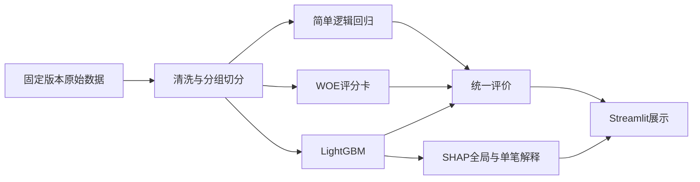

# 金融进修第一期：信贷评分卡开发

输入客户信息，得到模型预测的严重逾期概率；评分卡给出信用分，SHAP 说明 LightGBM 的预测依据。本项目用于团队研究与教学演示。

**三模型、单笔/全局 SHAP、Streamlit 页面和完整运行入口已接通。** 全新 Python 3.11 环境完成真实数据流程，279 项业务测试通过。成员现场讲解与最终认可仍由本人完成。



## 内容总览

| 你想做什么 | 入口 |
| --- | --- |
| 跑起来、复现、演示 | [运行与验收](docs/运行与验收.md) |
| 看方法、真实结果与限制 | [项目报告](reports/final/项目报告.md) |
| 看数据字段与接口 | [接口约定](docs/接口约定.md) |
| 看三人分工 | [任务认领](docs/任务认领.md) |
| 完成个人练习 | [六项练习](learning/README.md) |

## 跑一次，再打开页面

按[首次上手](docs/首次上手.md)建立 Python 3.11 环境，取得指定的 `data/raw/cs-training.csv` 后运行：

```powershell
.venv\Scripts\python.exe run_project.py --output artifacts/team/run-001
.venv\Scripts\python.exe -m streamlit run app.py --server.address 127.0.0.1 --server.port 8503
```

第一条命令完成环境检查、三模型训练、独立数据审计、模型重载核对与批量解释。第二条命令打开页面，选择实验及模型，输入客户信息即可评估。输出目录必须是新目录。

| 模型 | 页面显示什么 |
| --- | --- |
| 简单逻辑回归 | 严重逾期概率，作为简单对照 |
| WOE/IV 评分卡 | 概率、信用分和变量分项；风险越高，分数越低 |
| LightGBM | 概率、该客户的 SHAP 贡献和本实验全局重要性 |

## 本次真实研究结果

同一内部测试分区，共 22,508 行；标签 1 表示两年内发生 90 天或以上严重逾期。以下来自本次完整运行的固定模型与阈值。

| 模型 | AUC ↑ | KS ↑ | AP ↑ | Brier ↓ |
| --- | ---: | ---: | ---: | ---: |
| 简单逻辑回归 | 0.823521 | 0.506524 | 0.352951 | 0.052596 |
| WOE/IV 评分卡 | 0.855528 | 0.545791 | 0.372150 | 0.050385 |
| LightGBM | 0.871837 | 0.577973 | 0.411703 | 0.048351 |

LightGBM 在本次内部研究比较中表现较好；结果不能直接推断未来客户或实际授信效果。SHAP 贡献的单位是 log-odds，不是概率百分点或因果效应。完整证据和数值差异说明见[项目报告](reports/final/项目报告.md)。

## 团队与协作

| 成员 | 账号 | 原有主责 |
| --- | --- | --- |
| 吴晓亦 | Sally-yi | 数据清洗、探索、分区与数据审计 |
| 杨曦 | Clement-xi | WOE/IV、评分卡与界面 |
| 郭宇哲 | morebadly | 简单模型、LightGBM、评价与解释 |

项目负责人 ThreshoLdnnis 统筹共享入口和报告；按用户要求由 Codex 协助完成最终联调、页面解释及技术验收。已运行的技术验证与成员本人理解、讲解分别记录。

日常以 `main` 为正式入口，变更走任务分支与 PR。原始数据、模型和逐行产物留在本地，不提交 GitHub。数据按 [Kaggle 官方页面](https://www.kaggle.com/competitions/GiveMeSomeCredit/data) 的规则取得，项目不会在仓库分发原始文件。
