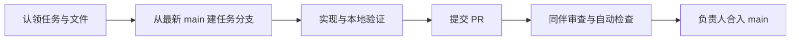

# 金融进修第一期：信贷评分卡开发

团队从零完成数据管线、逻辑回归评分卡、LightGBM、SHAP 和 Streamlit。**数据模块、简单 LR 与 WOE/IV 评分卡已实现；共享入口支持同一分区运行两套模型。LightGBM、SHAP 与页面按后续任务推进。**

这是本次团队项目的正式仓库，日常只从 **main** 进入。临时任务分支用于提 PR，合并后清理。

## 团队分工

| 成员 | GitHub 账号 | 主责 | 对应模块 |
| --- | --- | --- | --- |
| 吴晓亦 | [Sally-yi](https://github.com/Sally-yi) | 数据 | 数据读取与校验、清洗、训练集探索、分组切分与分区证据 |
| 杨曦 | [Clement-xi](https://github.com/Clement-xi) | 评分卡与界面 | WOE/IV、逻辑回归评分卡、信用评分、Streamlit 页面 |
| 郭宇哲 | [morebadly](https://github.com/morebadly) | 模型、评价和解释 | 简单 LR、LightGBM、统一评价、验证选择、SHAP 解释 |

项目负责人（ThreshoLdnnis）统筹接口、共享配置、集成与合并。三位成员分别补充本人模块的测试、实验记录和说明；六项个人练习由每人独立完成。

## 成员先做三件事

1. 用本人的 GitHub 账号接受仓库邀请，克隆本仓库，按[首次上手](docs/首次上手.md)完成环境与首次读数。
2. 到[任务分工](docs/任务认领.md)查看本人主责和对应 Issue，确认修改路径后再动手；函数接口按[接口约定](docs/接口约定.md)。
3. 按[协作约定](CONTRIBUTING.md)在任务分支提交，通过 PR 审查后合入 main。个人练习、日志和实验分别放在本人用户名目录下。



## 常用入口

| 想做什么 | 打开哪里 |
| --- | --- |
| 查看一周安排、分工和验收 | [任务认领](docs/任务认领.md) |
| 写业务代码 | `src/`；主责按模块认领，接口见 [约定](docs/接口约定.md) |
| 完成六项个人练习 | [learning/README.md](learning/README.md) |
| 记录个人进展 | [worklogs/README.md](worklogs/README.md) |
| 记录本人的真实实验 | [experiments/README.md](experiments/README.md) |
| 阅读六项练习详细要求 | [学员任务书](docs/学员任务书.md) |

## 运行模型

取得指定的 `data/raw/cs-training.csv` 并安装团队依赖后，在仓库根目录运行：

```powershell
.venv\Scripts\python.exe run_pipeline.py --models baseline scorecard
```

默认生成新的本地 `artifacts/team/` 实验目录。两套模型复用一次清洗和分组切分，各自只用训练集拟合、用验证集确定阈值；全部阈值保存后再评价测试集。

| 想运行什么 | 命令参数 |
| --- | --- |
| 简单 LR 与评分卡 | `--models baseline scorecard` |
| 仅评分卡 | `--models scorecard` |
| 仅简单 LR（原有默认行为） | `--models baseline`，或省略 `--models` |

常用产物：`model_comparison.csv` 是按模型和分区排列的汇总比较表；`model_metrics.json` 保存两套模型的指标；`scorecard_binning.json` 保存原生分箱、IV 与评分尺度。模型、分区成员、逐行概率、信用分和分项保存在本地，不上传仓库。

可用 `--input`、`--config`、`--output` 指定路径；输出目录必须尚不存在。原有三参数 `run_experiment(data_path, output_dir, settings)` 继续默认运行简单 LR；同时运行两套时加 `models=('baseline', 'scorecard')`。接口和文件说明见 [接口约定](docs/接口约定.md)，修复与真实运行结果见 [T03–T04 联调验收](reports/T03-T04联调验收.md)。

## 当前进度

| 内容 | 状态 |
| --- | --- |
| 工程目录、接口、协作说明和六项练习框架 | 已准备 |
| 数据处理、探索与简单 LR 链路 | 已实现；T03 已用指定真实数据验证 |
| WOE/IV 与评分卡 | 已实现；共享入口可输出概率、信用分和分项 |
| LightGBM、统一评价曲线、SHAP 与页面 | 待后续任务实现 |
| 模块测试、团队实验与最终报告 | 已有数据、模型及共享入口测试；实验见联调验收，最终报告待整合 |

CI 只检查仓库格式、语法和已经提交的练习或测试。绿色检查不代表待实现的系统已经完成。

## 数据与结果

真实数据按 [Kaggle Give Me Some Credit 官方页面](https://www.kaggle.com/competitions/GiveMeSomeCredit/data) 的规则自行取得，放在本地 `data/raw/`。不提交原始数据、训练模型、逐行预测、账号密钥或虚拟环境。个人原有实操、文章成绩和人工小例子均不计为团队真实实验。
