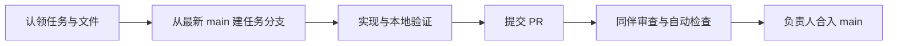

# 金融进修第一期：信贷评分卡开发

团队从零完成数据管线、逻辑回归评分卡、LightGBM、SHAP 和 Streamlit。**当前处于开工准备阶段：业务函数为 TODO，尚无团队真实模型结果。**

这是本次团队项目的正式仓库，日常只从 **main** 进入。临时任务分支用于提 PR，合并后清理。

## 团队分工

| 成员 | 主责 | 对应模块 |
| --- | --- | --- |
| 吴晓亦 | 数据 | 数据读取与校验、清洗、训练集探索、分组切分与分区证据 |
| 杨曦 | 评分卡与界面 | WOE/IV、逻辑回归评分卡、信用评分、Streamlit 页面 |
| 郭宇哲 | 模型、评价和解释 | 简单 LR、LightGBM、统一评价、验证选择、SHAP 解释 |

项目负责人（ThreshoLdnnis）统筹接口、共享配置、集成与合并。三位成员分别补充本人模块的测试、实验记录和说明；六项个人练习由每人独立完成。

## 成员先做三件事

1. 用本人的 GitHub 账号接受仓库邀请，克隆本仓库，按[首次上手](docs/首次上手.md)完成环境与首次读数。
2. 到[任务分工](docs/任务认领.md)查看本人主责和对应 Issue，确认修改路径后再动手；函数接口按[接口约定](docs/接口约定.md)。
3. 按[协作约定](CONTRIBUTING.md)在任务分支提交，通过 PR 审查后合入 main。个人练习、日志和实验分别放在本人用户名目录下。

## 常用入口

| 想做什么 | 打开哪里 |
| --- | --- |
| 查看一周安排、分工和验收 | [任务认领](docs/任务认领.md) |
| 写业务代码 | `src/`；主责按模块认领，接口见 [约定](docs/接口约定.md) |
| 完成六项个人练习 | [learning/README.md](learning/README.md) |
| 记录个人进展 | [worklogs/README.md](worklogs/README.md) |
| 记录本人的真实实验 | [experiments/README.md](experiments/README.md) |
| 阅读六项练习详细要求 | [学员任务书](docs/学员任务书.md) |

## 当前进度

| 内容 | 状态 |
| --- | --- |
| 工程目录、接口、协作说明和六项练习框架 | 已准备 |
| 数据处理、探索、简单 LR 与评分卡 | 待团队实现 |
| LightGBM、评价、SHAP、页面与业务测试 | 待团队实现 |
| 团队真实实验和最终报告 | 待运行与记录 |

CI 只检查仓库格式、语法和已经提交的练习或测试。绿色检查不代表待实现的系统已经完成。

## 数据与结果

真实数据按 [Kaggle Give Me Some Credit 官方页面](https://www.kaggle.com/competitions/GiveMeSomeCredit/data) 的规则自行取得，放在本地 `data/raw/`。不提交原始数据、训练模型、逐行预测、账号密钥或虚拟环境。个人原有实操、文章成绩和人工小例子均不计为团队真实实验。
