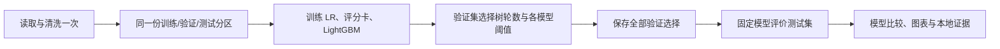

# LightGBM 如何接入共享入口

`src/tree_model.py` 负责训练和预测，`run_pipeline.py` 负责安排模块调用。接入后全员可以用同一个命令完成三模型比较。树模型与统一评价归属郭宇哲；本次由负责人授权协调入口、测试和说明。

## 接入的四步

1. **注册模型。** 导入 `fit_tree`、`predict_tree`，在 `_selected_models` 和 CLI 的 `--models` 中加入 `tree`。保留默认 Baseline 和原三参数 API。
2. **分派训练。** LR 接收完整配置，评分卡接收 `config['scorecard']`。LightGBM 接收训练集、验证集和完整配置；验证集用于 AUC 早停。三个模型共用一次清洗和同一份分区位置，测试集不传给训练函数。
3. **统一预测和评价。** `_predict_model` 把树模型的一维概率包装为保留输入索引的 DataFrame。旧 `validation_threshold` 和 `metrics` 接口委托 `src/evaluation.py`，全模型使用同一阈值规则和指标定义。
4. **补齐记录与测试。** 在 `record['models']['tree']` 保存最佳轮数、实际评价轮数与验证历史；统一保存模型、逐行预测和 validation/test 图表；产物哈希递归覆盖图表。

训练分派的关键调用是：

```python
bundle = fit_tree(
    train_x, train_y,
    features.iloc[validation_pos], y.iloc[validation_pos],
    config,
)
```

全部模型先完成训练、验证选择，并将全部阈值写入 `selections.json`；之后才开始任何测试预测。树模型推理由 `predict_tree` 显式使用已保存的 `best_iteration`，不重新拟合。



## 如何运行与查看

在项目环境中运行：

```powershell
python run_pipeline.py --models baseline scorecard tree
python run_pipeline.py --models tree
```

输出目录默认为新的 `artifacts/team/models-日期-随机编号/`，也可用 `--input`、`--config`、`--output` 指定路径。

| 产物 | 看什么 |
| --- | --- |
| `model_comparison.csv` | 三模型、三个分区，共 9 行指标 |
| `record.json` 的 `models.tree` | `best_iteration`、`evaluation_rounds`、验证 AUC 历史和完整参数 |
| `figures/validation/`、`figures/test/` | ROC、PR、校准图；有评分卡时另有信用分分布 |
| `tree.joblib`、`tree_predictions.csv` | 可复用的模型与逐行概率，留本地 |
| `selections.json` | 测试预测开始前已固定的所有模型阈值 |

原有 `metrics.json`、`selection.json`、`record['model']` 仍是首个模型的兼容视图；三模型运行时首个模型为 Baseline。比较全部模型请读 `model_metrics.json` 或 `record['models']`。

## 本次实际验证

2026-10-29，Windows / Python 3.11.16。业务测试 **206 项通过**，含新增 7 项三模型训练边界、树模型单独 CLI、失败路径和产物检查；14 条既有依赖弃用提示。Ruff 与仓库检查另行执行。

真实输入 SHA256 为 `1bd46da486a5708c58c7b01a034fae2a13b327f6f7b62ea7ba4fe3b5824b24ac`，150,000 行。训练/验证/测试为 **104,974 / 22,518 / 22,508**，位置与已审查的 T05 个人脚本逐项相同，组交集为 0。入口三模型的逐行概率、评分分项、标签和分区与该脚本的本地复现逐值相同；保存加载差为 0，全部产物哈希已核对。数值配置未改变。

| 模型 | 测试 AUC | 测试 KS | 验证阈值 |
| --- | ---: | ---: | ---: |
| baseline | 0.8235213591 | 0.5065242838 | 0.062970501593787157 |
| scorecard | 0.8555283926 | 0.5457907863 | 0.072231575951426027 |
| tree | 0.8718373023 | 0.5779727559 | 0.06673319462105777 |

LightGBM 最佳轮数 **257**、实际评价 **287** 轮。全部三模型共生成 8 张验证/测试图；只选择树模型时生成 6 张，不制造信用分。此次结果属于已有公开数据内部研究分区，不能证明时间外或实际业务效果。

此前审查中，评分卡验证集 AUC/AP/PR 面积与郭宇哲提交的汇总有小差异，最大 AP 差约 1.45e-6，原因未完全定位。本次共享入口与同机个人脚本复现一致，三模型测试分区指标与提交汇总一致；没有按测试成绩修改模型或覆盖原实验记录。

实际运行目录为工作区 `work/t05-shared-entry-20261029/real-data-reproduction/`。原始数据、模型和逐行预测不进入仓库；本地 Git 快照不冒称为远端提交。执行源码指纹如下：

| 文件 | SHA256 |
| --- | --- |
| `src/data.py` | `43aa72918d9d0b90e13b92f7d0dae993eb4471900d3c2c0ffd98be8780b9eb1d` |
| `src/baseline.py` | `e65a047362f3af4c9063ffe9efc8b10feb99890e07c0e40cae087bd5ada5edb9` |
| `src/evaluation.py` | `a70ad48445414f40633b72327913b79db444934e427b8c41a02948c993aa4040` |
| `run_pipeline.py` | `37bf6c076f6c5f39c1e5b39eeb0347b55f2405b5465e69ad501e05dcccf00a20` |
| `experiments/morebadly/run_t03.py` | `ac196b921dd53216bf200c932e74c65b48c78c3e09ccbb16e3d60e582b48dd9c` |
| `src/scorecard.py` | `2a6aee6ec876abb8356b6800a1ccc42834a1bac1871eea4738d9de3def69d5e1` |
| `src/tree_model.py` | `2a12a1a1b52811fe68b4a8852001b6844b45afef0750b882c6db7d39ab85f226` |

## 在 GitHub 上怎样提交

完成代码修改后先在本地运行测试和真实数据；GitHub 网页编辑器不能代替 Python 验证。在对应分支通过文件编辑或上传提交，选择 **Create a new branch**，再提 PR 查看 **Files changed** 和自动检查。负责人合并后，组员更新 `main` 即可获得统一入口。此集成以 T05 模块为依赖，合并顺序为 T05 模块 PR → 共享入口 PR。SHAP 和页面仍属于 T06。
