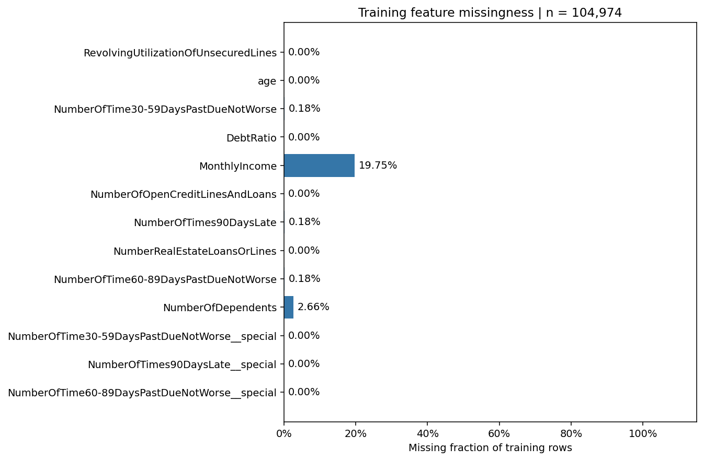
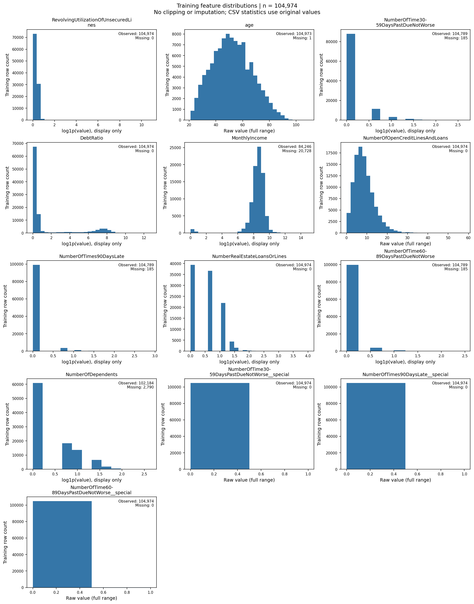
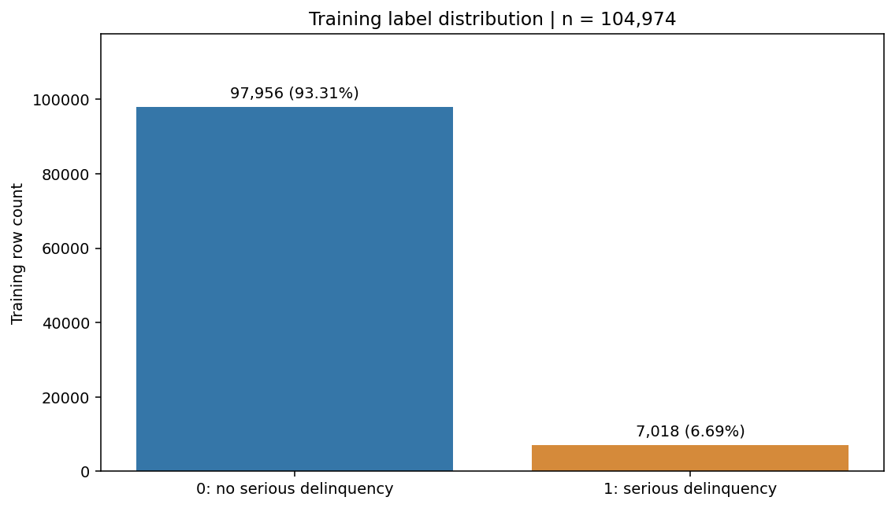
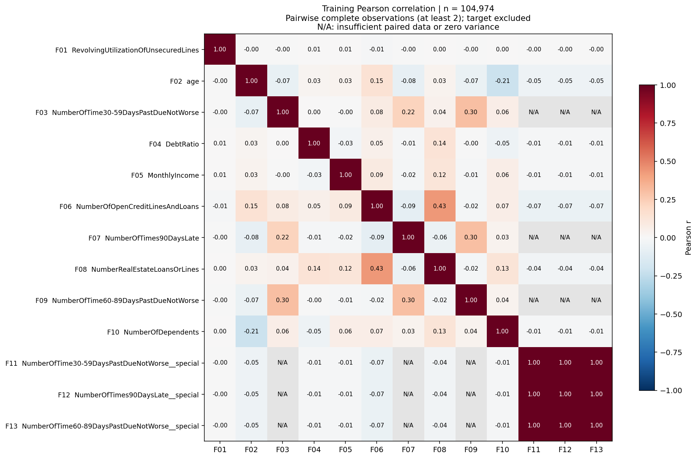

# Sally-yi T02 数据清洗与训练集探索

日期：2026-10-27（Asia/Shanghai）。任务：[T02 / Issue #2](https://github.com/ThreshoLdnnis/credit-risk-scoring-team/issues/2)。本次完成数据读取、固定规则清洗、分组切分、训练集探索和模块验证。代码与实验由 Codex 协助执行；本人复现讲解、同伴审查和负责人合并另行完成。

## 数据与清洗结果

使用本人下载的 Kaggle Give Me Some Credit `cs-training.csv`，共 150,000 行、12 列。原始文件 SHA256 为 `1bd46da486a5708c58c7b01a034fae2a13b327f6f7b62ea7ba4fe3b5824b24ac`，本次运行前后相同。标签 `SeriousDlqin2yrs=1` 表示两年内发生 90 天或以上严重逾期事件；不表示预期信用损失。

读取校验覆盖原始 CSV 重复表头、必需字段、非数值、无限值及有效 0/1 标签。空字段和官方文件中的 `NA` 识别为缺失，其他非法文本不会静默改成缺失。清洗输出固定顺序的 10 个特征和 3 个特殊值标记，共 13 列，排除序号、标签及其他字段。保持所有行和原有顺序。

- `age=0`：1 行转为缺失。
- `NumberOfTime30-59DaysPastDueNotWorse`：269 行命中 96/98。
- `NumberOfTimes90DaysLate`：269 行命中 96/98。
- `NumberOfTime60-89DaysPastDueNotWorse`：269 行命中 96/98。
- 以上三列各增加 `__special` 标记，再将 96/98 原值设为缺失。这是团队预先约定的研究规则，不是官方对特殊值含义的定义。
- 其他数值保留。缺失未填补、长尾未截断，未按标签调整规则；各模型后续仅在训练集拟合填补等参数。

| 字段 | 清洗前缺失数 | 清洗后缺失数 | 清洗后缺失率 |
| --- | ---: | ---: | ---: |
| RevolvingUtilizationOfUnsecuredLines | 0 | 0 | 0.0000% |
| age | 0 | 1 | 0.0007% |
| NumberOfTime30-59DaysPastDueNotWorse | 0 | 269 | 0.1793% |
| DebtRatio | 0 | 0 | 0.0000% |
| MonthlyIncome | 29731 | 29,731 | 19.8207% |
| NumberOfOpenCreditLinesAndLoans | 0 | 0 | 0.0000% |
| NumberOfTimes90DaysLate | 0 | 269 | 0.1793% |
| NumberRealEstateLoansOrLines | 0 | 0 | 0.0000% |
| NumberOfTime60-89DaysPastDueNotWorse | 0 | 269 | 0.1793% |
| NumberOfDependents | 3924 | 3,924 | 2.6160% |
| NumberOfTime30-59DaysPastDueNotWorse__special | 新增标记列 | 0 | 0.0000% |
| NumberOfTimes90DaysLate__special | 新增标记列 | 0 | 0.0000% |
| NumberOfTime60-89DaysPastDueNotWorse__special | 新增标记列 | 0 | 0.0000% |

本表是固定规则的全量数据审计，不用于根据验证或测试表现选择处理规则。

## 分组切分与隔离

按全部 13 个清洗后输入列定义内容组，缺失以一致方式参与；相同输入的行绑定同组，保留原始逐行标签。共 149,353 组，相对每组一行多出 647 行，其中 38 组有不同标签。组内最大标签只用于分层。

使用 seed=42，先按组分层留出 30%，再将留出组按组分层各分一半，目标组比例 70%/15%/15%。`split_dataset` 返回原始行位置，以 `.iloc` 对齐特征与标签；组大小不同会使行比例略有差异。

| 分区 | 行数 | 行比例 | 组数 | 标签 1 行数 | 标签 1 比例 |
| --- | ---: | ---: | ---: | ---: | ---: |
| train | 104,974 | 69.9827% | 104,547 | 7,018 | 6.6855% |
| validation | 22,518 | 15.0120% | 22,403 | 1,507 | 6.6924% |
| test | 22,508 | 15.0053% | 22,403 | 1,501 | 6.6687% |

实际检查：全体 150,000 行恰好覆盖一次；两两分区的内容组交集为 0；三个分区都有两类；相同 seed 重跑得到完全相同的位置数组。上述标签比例仅作为分层审计，未进行验证/测试集 EDA、调参或模型评价。

## 训练集探索

图表与统计只使用训练分区的 104,974 行。完整汇总表在 [训练缺失率](T02/missing_summary.csv)、[单变量描述统计](T02/feature_summary.csv)、[标签分布](T02/label_counts.csv)、[相关矩阵](T02/correlation_matrix.csv) 与 [方法说明](T02/summary.json)。



训练集中，月收入缺失 20,728 行（19.7458%），受扶养人数缺失 2,790 行（2.6578%）。年龄缺失仅 1 行，图中的 0.00% 是显示精度舍入，并非无缺失。特殊值处理带来的逾期缺失单独保留标记。后续填补参数应由各模型在训练集拟合，不能使用全量中位数。



部分金额比率和计数呈长尾分布，不能把横轴密集区域直接解释为全部取值范围。图中的显示变换以轴标题为准，数值表保留原尺度；本次没有因为长尾删行或截断。



标签 1 占比较低，类别不均衡。仅凭准确率高不能说明模型能够识别严重逾期；实际模型评价由后续任务实现，本次不报告 AUC 等指标。



相关性基于训练集、成对有效样本的 Pearson 相关，不包含标签。三个特殊值标记在本训练集同时出现，彼此相关系数为 1.00；仍按既定接口保留，后续模型处理需由负责人对齐。逾期计数与特殊标记的部分相关项为 N/A：标记为 1 时计数已设为缺失，成对有效样本中标记恒为 0，所以相关性不可定义。相关性不等于因果关系，本次没有据此自行删除特征。

## 本地产物与复现

运行目录：`artifacts/Sally-yi/EXP-001-20261027-reviewed`（Git 忽略，不上传）。

- `cleaned_features.parquet`：150,000 行、13 列的清洗特征，无标签，行序对应原始 CSV。
- `split_positions.npz`：三个分区的行位置数组，供下游模型复用。
- `split_members.csv`：原始行位置、原始序号、内容组编号、SHA256 内容指纹和分区名称。
- `manifest.json`：输入和输出校验值、代码文件 SHA256、运行时 Git 状态、环境版本和命令。
- `summary.json` 与 `training_eda/`：清洗及分区汇总、训练集统计与图表。

在仓库根目录执行（Windows PowerShell）：

```powershell
& .venv/Scripts/python.exe -X utf8 experiments/Sally-yi/run_t02.py
& .venv/Scripts/python.exe -X utf8 -m pytest -q tests
```

默认每次生成新的本地目录，不覆盖既有实验。原始数据需按 Kaggle 规则自行取得。复现脚本未改动负责人维护的共享 `run_pipeline.py`、配置、依赖或队友模块。

下游复用：从本地 `split_positions.npz` 读取 `train/validation/test`，对 `cleaned_features.parquet` 与原始 CSV 的标签同时使用 `.iloc[positions]`；不得再次自行随机切分。或用相同版本的模块对同一 SHA256 的原始文件和 seed=42 复现。

## 验证与边界

- 业务测试：`python -m pytest -q tests`，76 项通过，覆盖读取边界、固定规则、混合标签重复组、位置对齐、分区隔离、可复现性、EDA 汇总和本地产物。
- 仓库边界、Ruff、Python 编译检查按团队 CI 命令执行，验证结果见今日日志。
- 六项个人练习未在本次提交；`check-all` 的“尚无个人练习提交”不表示练习通过。
- 无参数运行 `pytest` 会收集公共练习模板并因找不到 `exercises` 模块而中断；本次按团队 CI 使用 `pytest -q tests`，未修改共享练习配置。
- 本次未训练模型、计算模型效果、运行完整业务管线或验收页面。公开数据重新切分不能证明时间外或实际业务效果。

下一步：本人复现并讲解清洗与防泄漏逻辑；请同伴审查 PR，负责人确认后合并；与模型负责人对接这份固定分区。
