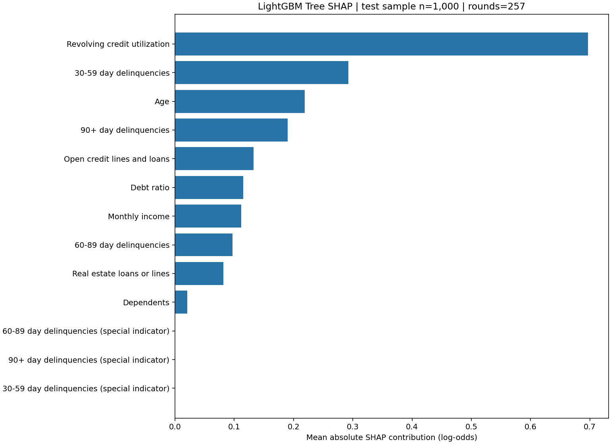

# 模型、评价与解释部分：郭宇哲（morebadly）

本章供T07负责人整合，覆盖T03简单LR、T05 LightGBM/统一评价、T06 SHAP及本人模块复现。实际执行由Codex协助，成员现场讲解另行验收。来源为已合并T03/T05与本次 [T06/T07实验](../../experiments/morebadly/T06-T07-EXP-001/README.md)；未把未接入的页面或其他成员工作计为本章交付。

## 数据口径与建模方法

使用有标签Give Me Some Credit `cs-training.csv`，150000行，SHA256为 `1bd46da486a5708c58c7b01a034fae2a13b327f6f7b62ea7ba4fe3b5824b24ac`。正类为两年内90天及以上严重逾期事件。读取、固定清洗与内容组划分复用数据主责代码；标签及导出序号不入模，得到13列输入，固定seed42分为104974/22518/22508行，同组不跨区。

简单LR在训练集内学习中位数填补、缺失指示和标准化，再拟合C=1、L2、lbfgs逻辑回归。LightGBM原生处理NaN，训练分箱、无额外缩放/类别加权；学习率0.04、15叶、最小叶样本50、最多500轮。验证AUC早停耐心30轮，实际评价287轮、最佳257轮；保存和解释都显式使用最佳轮数。模型参数未依据测试结果调整。

各模型验证阈值由最大TPR-FPR的有限[0,1]候选选择，并列取较大值；所有选择保存后才预测测试集。分类规则是 `p>=threshold`，不是实际业务审批策略。统一报告AUC、KS=max(TPR-FPR)、AP、单独命名的梯形PR面积、Brier、Log loss及固定阈值混淆矩阵/Precision/Recall/F1。

## 结果与证据范围

| 模型 | 测试AUC | KS | AP | Brier | 本章使用的证据 |
| --- | ---: | ---: | ---: | ---: | --- |
| 简单LR | 0.823521 | 0.506524 | 0.352951 | 0.052596 | 本次新环境复现，与T05逐行概率差0 |
| LightGBM | 0.871837 | 0.577973 | 0.411703 | 0.048351 | 本次新环境复现，与T05逐行概率差0 |
| 评分卡 | 0.855528 | 0.545791 | 0.372150 | 0.050385 | 已合并T05历史同分区对照；本次Windows未复现 |

评分卡由杨曦负责；第三行引用 [已合并T05比较](../../experiments/morebadly/T05-EXP-001/README.md)，不是本次新增评分卡结果。本次Windows应用控制阻止OR-Tools DLL，完整环境检查未通过，不能用本人的两模型成功替代三模型成功。

LightGBM本次验证阈值为0.06673319462105777；测试TN/FP/FN/TP为16716/4291/336/1165，Precision=0.213526、Recall=0.776149、F1=0.334914。LR阈值为0.0629705015937871，TN/FP/FN/TP为17090/3917/484/1017。全部三分区指标、源码/配置/产物哈希及验证历史保存于 [本次manifest](../../experiments/morebadly/T06-T07-EXP-001/run_manifest.json)。

本次新环境重新预测全部150000行，两模型的原始行序、序号、标签、分区、验证阈值、所有指标及模型保存加载均已核对；内容组交集为0。validation/test六张新评价图留在本地产物并纳入哈希。历史T05提供三模型八张聚合评价图，两个实验的来源分开记录。

## 解释定义与实际核验

Tree SHAP解释正类原始log-odds。固定为 `model_output='raw'`、`tree_path_dependent`，背景是训练104974行在已拟合树中的路径/叶计数，未将验证/测试样本用作背景。独立Booster只包含最佳257轮，不修改推理对象。

从固定测试分区按seed42均匀无放回抽1000行，按原位置排序，未按标签、概率或贡献挑选。`base + sum(SHAP) = raw` 的最大绝对误差为 **1.49e-14**；`sigmoid(raw) = 离线正类概率` 的最大误差为 **1.11e-16**。单行/批量、列重排及保存加载一致，完整13列按训练顺序返回。

该样本中，循环信贷使用率、30–59天逾期次数、年龄的平均绝对log-odds贡献排名前三。图中英文短标签对应 [完整字段CSV](../../experiments/morebadly/T06-T07-EXP-001/global_importance.csv)。平均绝对值只说明这个模型在该样本上的贡献大小，不说明方向或因果效应；三个special列在本样本贡献为0，也不代表业务无关。

本地局部图展示8项主要贡献和其他5项有符号总和，保留完整加和；正贡献增加模型严重逾期倾向、负贡献降低倾向，单位不是概率百分点或信用分。逐行解释、局部图、模型与原始数据不提交，仓库仅保留聚合审计与图表。

## 复现、限制与后续验收

在空白Python3.11.16环境和干净源码副本中，pip check通过、受约束的安装版本差异0；本人相关测试110项通过、三模型E2E在本机未选。首版PR的Linux完整业务CI通过，最终CI以发布提交为准。Windows的完整环境失败与成功的本人模块复现分别保留，详见 [复现与演示](../morebadly/T07_复现与演示.md)。

公开训练集及固定内部测试已参与开发，结果不能证明新的独立、时间外、客户外或实际授信效果。验证集同时选择轮数和阈值；本次没有额外概率校准、业务成本或统计显著性验收。数据取得方式是真实镜像下载，不冒称本次直接从Kaggle获取。

本人代码、测试、真实解释、模型复现与报告材料已提供；页面tree/SHAP接入由杨曦完成，负责人整合最终报告并组织同伴审查。成员本人现场运行、代码讲解和小改演示仍需实际进行，不能以AI执行替代。个人练习按用户要求暂不提交；共享Issue #6/#7保留其他成员及团队验收事项。
