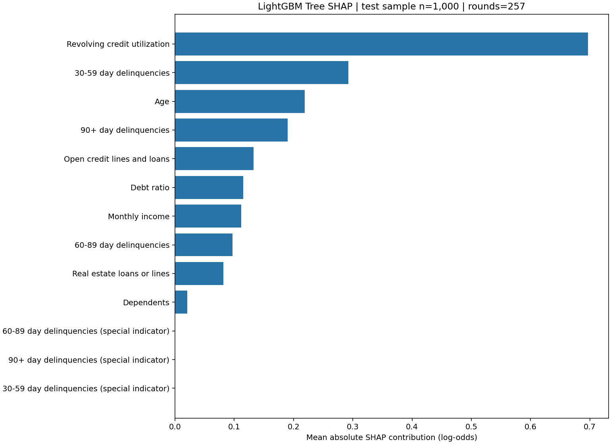

# 智能信贷风控评分卡与可解释性分析系统

## 交付范围与执行

本工程完成数据管线、简单逻辑回归、WOE/IV逻辑回归评分卡、LightGBM、统一评价、全局/单笔 SHAP 及 Streamlit 研究页面。项目负责人统筹，吴晓亦、杨曦、郭宇哲按原分工贡献模块；按用户要求由 Codex 协助完成最后的页面解释、完整入口、报告整合和技术验收。

本报告数据来自 **2026-10-31T01:11:44.961929+08:00** 完成的实际运行。使用全新 Python 3.11.16 虚拟环境，通过 requirements/constraints 安装76个运行包，关闭用户 site-packages，依赖导入及兼容性检查通过。不是复用旧环境冒充新安装。源码及产物指纹见 [验收摘要](验收摘要.json)；成员个人材料与本次整体验收范围分别保留。

## 数据和研究分区

使用 Give Me Some Credit 有标签训练文件，共150000行。正类为两年内发生90天或以上严重逾期，正类10026行，比例6.684%。本次复用既有授权取得的本地文件，没有重新下载；字节与团队指定指纹一致。官方来源为 [Kaggle Give Me Some Credit](https://www.kaggle.com/competitions/GiveMeSomeCredit/data)。

SHA256：`1bd46da486a5708c58c7b01a034fae2a13b327f6f7b62ea7ba4fe3b5824b24ac`。

原始10个特征排除标签和导出序号。年龄0转缺失；三类逾期计数96/98分别增加特殊标记后转缺失，形成13列。保留其他极端值及原始逐行标签，不对全部数据学习填补、缩放或监督分箱。详细字段及边界见[数据章节](Sally-yi_数据部分.md)。

按13列清洗输入的内容分组，以seed42按组70/15/15切分：

| 分区 | 行数 | 内容组 | 严重逾期行数 |
| --- | ---: | ---: | ---: |
| 训练 | 104974 | 104547 | 7018 |
| 验证 | 22518 | 22403 | 1507 |
| 测试 | 22508 | 22403 | 1501 |

独立数据审计验证清洗表、位置数组、原始序号、内容指纹和标签逐行对应；全部行恰好覆盖一次，组交集为0。全表149353组，其中38组有不同标签；组最大标签只辅助分层，不覆盖原y。相同特征分组不能证明真实客户或时间外独立性。

## 三条建模路线

简单LR在训练内拟合中位数填补、缺失指示、标准化和L2逻辑回归，作为易解释的简单对照。评分卡使用训练内OptBinning原生WOE/IV、按IV阈值选变量并拟合逻辑回归；保留逐箱好坏计数、求解状态和缺失策略。LightGBM原生处理NaN，学习率0.04、15叶、最小叶样本50、最多500轮，验证AUC早停耐心30轮，实际评价287轮、最佳257轮。

信用分仅由评分卡产生：BaseScore=600、BaseOdds=20（好:坏）、PDO=20，Factor=20/ln(2)，Offset=600−Factor×ln(20)，Score=Offset−Factor×logit(p)。基础分及全部变量分项之和等于未取整总分；风险概率越高，信用分越低。

每个模型的阈值由验证集最大TPR−FPR选择，并列取较大的有限[0,1]候选。全部模型及阈值固定后再评价测试集，使用 `p>=threshold`。测试结果不用于本次调参；AP与梯形PR面积分别命名。

## 本次统一评价

| 模型 | AUC ↑ | KS ↑ | AP ↑ | Brier ↓ |
| --- | ---: | ---: | ---: | ---: |
| 简单逻辑回归 | 0.823521 | 0.506524 | 0.352951 | 0.052596 |
| WOE/IV 评分卡 | 0.855528 | 0.545791 | 0.372150 | 0.050385 |
| LightGBM | 0.871837 | 0.577973 | 0.411703 | 0.048351 |

测试集为同一22508行。LightGBM内部测试AUC最高、Brier最低；这里只比较本次固定内部研究样本，不作业务收益、显著性或部署结论。LightGBM测试TN/FP/FN/TP为16716/4291/336/1165，验证阈值0.06673319462105777；Precision0.213526、Recall0.776149、F1=0.334914。

模型重载逐行概率均满足原有 `1e-14` 容差；评分卡26行有最大 `1.6653345369377348e-16` 的变化，打破部分并列后使排序指标略有差异。工具分别验证保存概率的历史指标和重载概率的诊断指标，本次总体复验状态为 `completed_audit_with_reloaded_numeric_differences`。保存的全部指标可重算，原始阈值和记录未改写；不将重载排序指标表述为完全相同。

## SHAP 与界面

Tree SHAP显式解释正类原始log-odds，使用最佳257轮的独立Booster，背景为训练104974行在树中保存的路径/叶计数。固定seed42从测试分区均匀无放回抽1000条，不按标签或预测挑选。加和最大误差 1.488e-14，sigmoid概率映射最大误差 1.11e-16；单行/批量和列重排一致。

本次全局图与已提交的相同固定模型/样本图逐字节一致，复用聚合图：

页面展示同一实验的三模型比较、手工输入、概率、评分卡分值贡献，以及LightGBM局部累计贡献。前8项之外的5项作为有符号总和计入，基础值加全部贡献还原原始输出。红色增加、蓝色降低模型严重逾期倾向；不能解释成概率百分点、信用分或因果影响。全局平均绝对贡献只表示该样本的贡献大小，不表示方向。

全局解释必须与当前实验记录、实际tree文件、解释汇总文件和有效轮数匹配；错配时提示不可用。页面再次检查局部特征/行顺序、正类、贡献加和和预测概率。解释失败不清除已经成功的概率预测。

## 技术验收

- 全新依赖环境中 279 项业务测试通过，Ruff与仓库交付检查另见PR自动检查。
- `run_project.py` 完成三模型训练、吴晓亦的独立数据审计、郭宇哲的模型/解释核验及页面产物关联检查，退出码0。
- 真实保存模型在六种页面组合中通过：三模型分别使用常规输入及缺失/特殊值输入；页面概率、评分卡信用分与离线一致，LightGBM全局和局部解释正常；非法输入被拒绝。
- 逐行模型、数据、样本位置、局部图及SHAP保存在本地；仓库只提交聚合结果、方法和验收指纹。

完整运行与现场步骤见[运行与验收](../../docs/运行与验收.md)。执行时Git提交为本地验收快照，发布后按源文件SHA256核对相同代码，不把本地快照SHA冒充远端main。

## 限制与仍需本人完成的事项

这是公开历史数据的内部研究，验证集同时参与早停和阈值选择，数据已多次用于开发。没有新的独立盲测、时间外、真实客户外或业务收益验证；没有额外校准、损失率、收益、公平性或生产授信验收。

此前郭宇哲机器的Windows原生依赖失败记录仍保留；本次负责人新环境成功不代表另一台机器的限制被远程修复。三位成员的个人练习、现场运行、代码讲解、小改及负责人最终认可需由本人实际完成，程序技术验收不代替这些环节。
